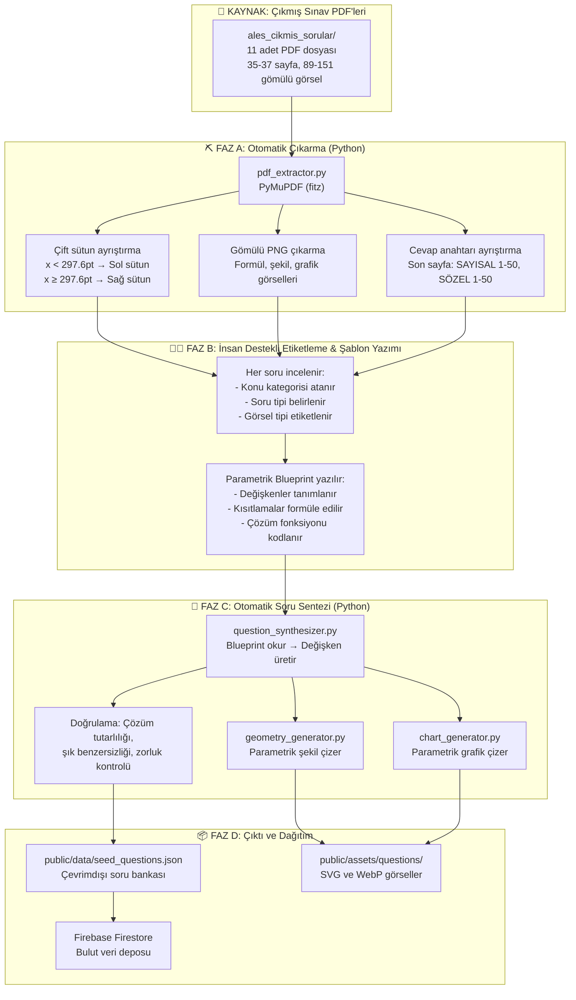

# 🎯 ALES Akıllı Soru Bankası & Çalışma Platformu (ALES Asistanı)
### Kapsamlı Proje Mimarisi, Sistem Tasarımı ve Geliştirme Kurgusu

---

## 1. 📌 Yönetici Özeti ve Temel İlkeler

**ALES Asistanı**, ALES (Akademik Personel ve Lisansüstü Eğitimi Giriş Sınavı) hazırlık sürecindeki adayların en büyük iki engeli olan **zaman baskısı** ve **soru üzerinde işlem/tablo yapma zorunluluğunu** modern web teknolojileriyle çözen, tamamen **ücretsiz**, **açık kaynak**, **reklamsız** ve **minimalist** bir akıllı çalışma platformudur.

### Temel Tasarım İlkeleri:
1. **Apple Benzeri Sadeliğe Sahip Giriş:** E-posta onayı, SMS kodu, telefon numarası gibi karmaşık ve yorucu süreçler **kesinlikle yoktur**. Kullanıcı yalnızca **Kullanıcı Adı** ve **Şifre** ile saniyeler içinde giriş yapar veya kaydolur.
2. **Sessiz ve Zen Odak (Sıfır Ses):** Platform hiçbir ses efekti, zil veya arka plan uyarısı **içermez**. Dikkat dağıtıcı unsurlar elenmiş, görsel mikro animasyonlar ve sakin renk tonları ile odaklanma en üst düzeye çıkarılmıştır.
3. **Karalama & Çizim Alanı (Dijital Scratchpad):** Geometri, sayı basamakları ve sözel/sayısal mantık sorularında kağıt-kalem arama ihtiyacını ortadan kaldıran, soruyla entegre yüksek hassasiyetli bir **Canvas Karalama Motoru** bulunur.
4. **Çıkmış Soru Mantığı & Sentetik Soru Üretimi:** ÖSYM çıkmış sorularının yapısal ve mantıksal şablonları Python tabanlı bir boru hattı (pipeline) ile analiz edilir; geometri şekilleri ve grafikler Python ile çizilerek telif riski taşımayan, özgün ve eşdeğer yeni sorular üretilir.

---

## 2. 📐 Proje Mimarisi ve Teknoloji Yığını

Platform; **sıfır sunucu maliyeti**, **yüksek hız** ve **cihaz bağımsız erişilebilirlik** (Mobil, Tablet/Stylus, Masaüstü) prensibiyle tasarlanmıştır.

```
┌──────────────────────────────────────────────────────────────────────────────┐
│                    OFFLINE / VERİ HAZIRLAMA (PYTHON PIPELINE)                │
├──────────────────────────────────────────────────────────────────────────────┤
│  [ PDF Çıkarıcı & Ayrıştırıcı ] ──► PyMuPDF / pdfplumber (Metin, Şık, Cevap) │
│  [ Kalıp & Mantık Analizi ]     ──► Soru Tipi, Zorluk ve Şablon Çıkarımı     │
│  [ Sentetik Soru Motoru ]       ──► Değişken Permütasyonu & Eşdeğer Soru     │
│  [ Geometri & Grafik Çizici ]   ──► Python (Matplotlib, Shapely, Svgwrite)   │
└──────────────────────────────────────┬───────────────────────────────────────┘
                                       │ JSON & SVG/WebP Çıktısı
                                       ▼
┌──────────────────────────────────────────────────────────────────────────────┐
│                           İSTEMCİ (CLIENT) KATMANI                           │
├──────────────────────────────────────────────────────────────────────────────┤
│  [ Ultra-Minimalist Arayüz ]    ──► Vanilla JS (ES Modules) + Modern CSS     │
│  [ Apple Tarzı Auth UI ]        ──► Sade Kullanıcı Adı + Şifre Formu         │
│  [ Çizim / Karalama Motoru ]    ──► HTML5 Canvas API (Pointer Events / Stylus│
│  [ Matematik & Formül ]         ──► KaTeX (Ultra Hızlı LaTeX Render)         │
│  [ İstemci Önbellek ]           ──► IndexedDB / LocalStorage (Cache-First)   │
└──────────────────────────────────────┬───────────────────────────────────────┘
                                       │
                            REST / SDK Entegrasyonu
                                       ▼
┌──────────────────────────────────────────────────────────────────────────────┐
│                         BULUT & DAĞITIM (BACKEND)                            │
├──────────────────────────────────────────────────────────────────────────────┤
│  [ Veritabanı & Kimlik ]        ──► Firebase Firestore + Lightweight Auth    │
│  [ Dağıtım & Hosting ]          ──► Firebase Hosting (Global CDN, .web.app)  │
│  [ CI/CD Otomasyonu ]           ──► GitHub Actions (Firebase Deploy)         │
└──────────────────────────────────────────────────────────────────────────────┘
```

### Teknoloji Seçim Matrisi

| Katman / Bileşen | Tercih Edilen Araç | Neden Seçildi? / Avantajı |
| :--- | :--- | :--- |
| **Geliştirme & Paketleme** | **Vite** | Anında HMR (Hot Module Replacement), sıfır konfigürasyon, ultra hafif bundle boyutu. |
| **Arayüz (Frontend)** | **HTML5 + Modern CSS + Vanilla JS** | Büyük framework'lerin (React, Angular) getirdiği yükü sıfırlar. Açılış hızı <1 saniye. |
| **Formül & Sembol Render** | **KaTeX** | Matematik formüllerinde MathJax'ten 10x daha hızlı, CSS tabanlı ve hafif render motoru. |
| **Çizim & Karalama** | **HTML5 Canvas API + Pointer Events** | Apple Pencil, S-Pen veya fare ile gecikmesiz çizim; geri alma (undo), silgi ve katman temizleme. |
| **Görsel & Geometri Üretimi** | **Python (Matplotlib, Shapely, Pillow)** | Geometri şekillerini, açı sembollerini ve istatistik grafiklerini vektörel/şeffaf olarak otomatik üretme. |
| **PDF Ayrıştırma & Analiz** | **Python (PyMuPDF / pdfplumber)** | 50 Mat + 50 Türkçe PDF kitapçıklarından soruları, şıkları ve cevap anahtarlarını yapılandırılmış veriye dönüştürme. |
| **Veritabanı** | **Firebase Firestore** | Ücretsiz Spark planı (50k okuma/gün). Hızlı NoSQL veri modeli. |
| **Kullanıcı Girişi (Auth)** | **Apple-Tarzı Minimalist Auth** | Sadece Kullanıcı Adı + Şifre. E-posta, telefon veya doğrulama adımları yok. |
| **Dağıtım (Hosting & CI/CD)** | **Firebase Hosting + GitHub Actions** | Sıfır sunucu maliyeti, Google CDN, temiz kök alan adı (`.web.app`), yerleşik Auth uyumu ve otomatik yayına alma. |

---

## 3. 🔐 Kullanıcı Girişi Tasarımı: "Apple Sadeliğinde" (Minimalist Auth)

Platformda kullanıcıyı yoran form alanları, e-posta aktivasyon mailleri ve SMS doğrulamaları **tamamen kaldırılmıştır**. 

### 3.1. Kullanıcı Arayüzü & Akış
* **Tek Ekran / İki Alan:** Yalnızca **Kullanıcı Adı** ve **Şifre**.
* **Otomatik Tanıma / Akıllı Geçiş:**
  * Kullanıcı adı daha önce kayıtlı değilse tek tıkla "Yeni Hesap Oluştur" moduna geçer veya kullanıcı tek butonla anında oturum açar.
  * İstenirse "Beni Hatırla" seçeneğiyle oturum tarayıcıda kalıcı olarak (IndexedDB / LocalStorage) saklanır; sonraki girişlerde şifre sormadan doğrudan çalışma ekranına yönlendirir.

### 3.2. Teknik Gerçekleştirim (Firebase ile E-postasız Entegrasyon)
Firebase Auth'un standart e-posta/şifre mekanizması arka planda şeffaf bir şekilde kullanılırken kullanıcıdan e-posta **asla istenmez**:
1. Kullanıcı adından sanal bir kimlik türetilir: `user_${cleanUsername}@ales.internal`.
2. Kullanıcının girdiği şifre doğrudan bu sanal e-posta ile Firebase Auth'a iletilir.
3. Kullanıcı arayüzünde sadece `username` görünür.
4. Böylece Firebase'in endüstri standardı oturum belirteçleri (JWT tokens), güvenlik kuralları ve şifreleme altyapısı eksiksiz kullanılırken kullanıcıya Apple sadeliğinde bir deneyim sunulur.

---

## 4. 🐍 Python Veri Çıkarma, Analiz ve Soru Üretim Mimarisi

### Büyük Resim: PDF'den Platforma Ulaşan Veri Yolculuğu



---

### 4.1. Gerçek PDF Yapısının Anatomisi (Analiz Sonuçları)

`ales_cikmis_sorular/` klasöründeki 11 PDF dosyası gerçek PyMuPDF analiziyle incelenmiştir. Aşağıdaki bulgular, tüm pipeline kararlarının temelini oluşturur:

#### A. PDF Envanter Özeti

| Dosya | Sayfa | Gömülü Görsel | Metin Uzunluğu | Cevap Anahtarı |
| :--- | :---: | :---: | :---: | :---: |
| ALES1_sorular.pdf | 36 | 99 | 57.891 | ✅ Son sayfa |
| ALES1_sorular-2.pdf | 36 | 129 | 56.819 | ✅ Son sayfa |
| ALES1_sorular-3.pdf | 36 | 89 | 55.799 | ✅ Son sayfa |
| ALES2_sorular.pdf | 37 | 96 | 57.748 | ✅ Son sayfa |
| ALES2_sorular-2.pdf | 37 | 116 | 55.661 | ✅ Son sayfa |
| ALES2_sorular-3.pdf | 36 | 110 | 53.946 | ✅ Son sayfa |
| ALES3_sorular.pdf | 37 | 116 | 58.968 | ✅ Son sayfa |
| ALES3_sorular-2.pdf | 36 | 127 | 60.397 | ✅ Son sayfa |
| ALES2-12112019.pdf | 36 | 128 | 61.547 | ✅ Son sayfa |
| ALES3-12112019.pdf | 37 | 151 | 62.983 | ✅ Son sayfa |
| ALESILKBAHAR24072018.pdf | 35 | 113 | 53.572 | ✅ Son sayfa |

#### B. Sayfa Yapısı ve Kritik Tespitler

1. **Fiziksel Sayfa Boyutu:** A4 (595.3 × 822.0 pt). Ortadan ikiye bölen eksen: **x = 297.6 pt**.
2. **İlk 2 Sayfa:** Kapak ve yönerge sayfaları (soru yok).
3. **Sayfa 3 ila Sondan 1 Önceki:** Sorular — önce SAYISAL (50 soru), ardından SÖZEL (50 soru).
4. **Son Sayfa:** Cevap anahtarı. Format: `"SAYISAL TESTİ\n1.   B\n2.   A\n..."` ve `"SÖZEL TESTİ\n1.   B\n..."` şeklinde düz metin.
5. **Çift Sütun Düzeni:** Sol sütun (x < 297.6pt) ve sağ sütun (x ≥ 297.6pt). Her sütunda genellikle 2-3 soru yer alır.

#### C. Görsellerin Gerçek Doğası (En Kritik Bulgu)

> [!WARNING]
> **Matematik formülleri, geometri şekilleri, grafikler ve hatta şık metinleri PDF'te metin (text) olarak değil, gömülü raster PNG görseller olarak saklanmaktadır.** Bu, standart metin çıkarma yaklaşımının tek başına yetersiz olacağı anlamına gelir.

PDF'teki bloklar analiz edildiğinde üç farklı görsel kategorisi ortaya çıkar:

| Görsel Tipi | Tipik Boyut (pt) | Piksel Örneği | Açıklama |
| :--- | :--- | :--- | :--- |
| **Formül Görseli (Inline)** | ~49×10 pt (küçük, dar) | 775×167 px, 816×167 px | $\frac{a+b}{c}$, $\sqrt{x^2+1}$ gibi satır içi matematiksel ifadeler. Metin yerine PNG. |
| **Geometri / Şekil Görseli** | ~80×80 pt ile ~225×180 pt arası | 453×492 px, 1630×1873 px | Üçgenler, dikdörtgenler, çemberler, açı işaretleri, taralı alanlar, katı cisimler. |
| **Grafik / Tablo Görseli** | ~75×75 pt (daireler), ~224×55 pt (tablolar) | 289×286 px, 933×229 px | Dairesel grafikler (pie chart), matris/tablo görselleri, sütun grafikleri. |
| **Arka Plan Çizgisi (Satır Şeridi)** | 566×94 pt (tam sayfa genişliği) | 2357×393 px | Sayfanın satır arka plan şeritleri. **İçerik değil**, filtrelenmeli. |

#### D. Metin Çıkarma Gerçeği: Ne Geliyor, Ne Gelmiyor?

**Metin olarak çıkarılabilen:**
* Soru numaraları (`1.`, `2.`, ..., `50.`)
* Soru kök metinleri (uzun Türkçe cümleler, sözel mantık hikaye metinleri, problem metinleri)
* Şık etiketleri (`A)`, `B)`, `C)`, `D)`, `E)`)
* Şık metinleri (sayısal şıklar metin olarak gelen durumlar: `12`, `15`, `18`, `21`, `24`)
* Cevap anahtarı (son sayfa düz metin)

**Metin olarak çıkarılamayan — gömülü PNG olan:**
* Kesirli, köklü, üslü matematiksel ifadeler ($\frac{a}{b}$, $\sqrt[3]{x}$, $2^n$ vb.)
* Denklem ve eşitsizlikler
* Geometri şekilleri (üçgen, dörtgen, çember, koordinat düzlemi)
* İstatistik ve veri analiz grafikleri (daire, sütun, çizgi)
* Matris ve tablo görselleri (sayısal mantık soruları)
* Bazı şıklardaki formüller (şık içeriği de formül görseli olabilir)

---

### 4.2. Çıkarma Pipeline'ı: PDF'den Yapısal Veriye (`scripts/pipeline/`)

Çıkarma işlemi tam otomatik bir "sihirli çubuk" değildir. PDF'lerin yapısı gereği **yarı-otomatik (semi-automated)** bir boru hattı kullanılır: Python otomatik olarak çıkarabildiği her şeyi çıkarır, geri kalanı insan gözüyle etiketlenir.

#### Adım 1: Sayfa Türü Tespiti ve Filtreleme
```python
# scripts/pipeline/pdf_extractor.py - Sayfa rollerinin tespiti
COVER_PAGES = [0, 1]           # Kapak ve yönerge, atla
ANSWER_KEY_PAGES = [-1]         # Son sayfa: cevap anahtarı
# Geri kalan sayfalar: soru sayfaları
# SAYISAL sayfalar önce, SÖZEL sayfalar sonra gelir
# Geçiş noktası: "SÖZEL TESTİ" başlığının bulunduğu sayfa
```

#### Adım 2: Çift Sütun Ayrıştırma (Coordinate-Based Column Split)
```python
PAGE_MID_X = 297.6  # pt — A4 sayfasının tam ortası

def extract_column_blocks(page):
    """Sayfadaki tüm blokları sol/sağ sütuna ayırır."""
    blocks = page.get_text("dict")["blocks"]
    left_col, right_col = [], []
    
    for block in blocks:
        bbox = block["bbox"]  # (x0, y0, x1, y1)
        center_x = (bbox[0] + bbox[2]) / 2
        
        # 2357×393 px arka plan şeritlerini filtrele
        if block["type"] == 1:  # image block
            width_pt = bbox[2] - bbox[0]
            if width_pt > 500:  # tam sayfa genişliğinde → arka plan şeridi
                continue
        
        if center_x < PAGE_MID_X:
            left_col.append(block)
        else:
            right_col.append(block)
    
    # Y koordinatına göre sırala (yukarıdan aşağıya)
    left_col.sort(key=lambda b: b["bbox"][1])
    right_col.sort(key=lambda b: b["bbox"][1])
    
    return left_col, right_col
```

#### Adım 3: Soru Sınırlarının Tespiti (Question Boundary Detection)
* Her sütundaki metin blokları Y koordinatına göre sıralanır.
* Soru numarası regex'i (`r"^\s*(\d{1,2})\.\s*$"`) ile bir soru bloğunun başlangıcı tespit edilir.
* İki soru numarası arasındaki tüm bloklar (metin + görsel) o soruya ait olarak gruplandırılır.
* Sonuç: Her soru için `{ question_number, text_blocks[], image_blocks[], column }` nesnesi.

#### Adım 4: Gömülü Görsellerin Çıkarılması ve Sınıflandırılması
```python
def extract_and_classify_images(page, question_bounds):
    """Soruya ait görselleri çıkarır ve boyutlarına göre sınıflandırır."""
    for q in question_bounds:
        for img_block in q["image_blocks"]:
            bbox = img_block["bbox"]
            w_pt = bbox[2] - bbox[0]
            h_pt = bbox[3] - bbox[1]
            
            # Boyut tabanlı ön-sınıflandırma
            if w_pt < 60 and h_pt < 15:
                img_type = "inline_formula"      # Satır içi küçük formül
            elif 60 <= w_pt <= 200 and 50 <= h_pt <= 200:
                img_type = "geometry_or_chart"    # Geometri şekli veya grafik
            elif w_pt > 200 and h_pt < 70:
                img_type = "table_or_matrix"      # Geniş tablo / matris
            else:
                img_type = "unknown"              # Manuel kontrol gerekli
            
            # Görseli yüksek DPI ile dışa aktar
            # Dosya adı: {pdf_name}_S{sayfa}_Q{soru}_{tip}_{index}.png
            save_path = f"scripts/output/extracted/{pdf_stem}_S{page_num}_Q{q['number']}_{img_type}_{idx}.png"
```

#### Adım 5: Cevap Anahtarı Ayrıştırma (Answer Key Parser)
```python
def parse_answer_key(last_page_text):
    """Son sayfa metninden SAYISAL ve SÖZEL cevap anahtarlarını çıkarır."""
    # Gerçek format (PDF'den doğrulanmış):
    # "SAYISAL TESTİ\n1.   B\n2.   A\n...\n50.   E\nSÖZEL TESTİ\n1.   B\n..."
    
    answers = {"sayisal": {}, "sozel": {}}
    current_section = None
    
    for line in last_page_text.strip().split("\n"):
        if "SAYISAL" in line:
            current_section = "sayisal"
        elif "SÖZEL" in line:
            current_section = "sozel"
        else:
            match = re.match(r"(\d+)\.\s+([A-E])", line.strip())
            if match and current_section:
                answers[current_section][int(match.group(1))] = match.group(2)
    
    return answers  # {"sayisal": {1: "B", 2: "A", ...}, "sozel": {1: "B", ...}}
```

#### Adım 6: Ham Çıktı (Extracted Raw Data)
Çıkarma sonucu her PDF için şu yapıda bir JSON dosyası oluşturulur:

```json
{
  "source_pdf": "ALES1_sorular.pdf",
  "exam_name": "2021-ALES/1",
  "exam_date": "2021-05-02",
  "sections": {
    "sayisal": {
      "questions": [
        {
          "number": 1,
          "raw_text": "işleminin sonucu kaçtır?",
          "has_formula_images": true,
          "formula_image_paths": ["extracted/ALES1_S3_Q1_inline_formula_0.png"],
          "has_figure": false,
          "figure_paths": [],
          "options_text": ["", "", "", "", ""],
          "options_have_images": true,
          "option_image_paths": ["extracted/ALES1_S3_Q1_optA.png", "..."],
          "correct_answer": "B"
        },
        {
          "number": 44,
          "raw_text": "K köşesi AC kenarı üzerindedir.\nBuna göre, x kaç derecedir?",
          "has_formula_images": false,
          "has_figure": true,
          "figure_type": "geometry",
          "figure_paths": ["extracted/ALES1_S15_Q44_geometry_0.png"],
          "options_text": ["145", "146", "147", "148", "149"],
          "options_have_images": false,
          "correct_answer": "C"
        }
      ]
    },
    "sozel": { "questions": ["..."] }
  }
}
```

> [!NOTE]
> Bu ham çıktı **henüz platforma hazır değildir**. Formül görselleri PNG olarak çıkarılmış olsa da bunların KaTeX LaTeX metnine dönüştürülmesi, geometri şekillerinin yorumlanması ve soru mantığının parametrik hale getirilmesi bir sonraki fazda insan desteğiyle yapılır.

---

### 4.3. İnsan Destekli Şablon (Blueprint) Oluşturma Süreci

> [!IMPORTANT]
> **Neden Tam Otomatik Değil?**
> ÖSYM PDF'lerindeki matematik formülleri gömülü PNG olduğundan, OCR ile LaTeX'e dönüştürme hata payı yüksektir (özellikle iç içe kesirler, köklü ifadeler ve Türkçe'ye özgü notasyonlarda). Bunun yerine, **çıkarılan her soru insan tarafından bir kez incelenir** ve parametrik bir blueprint (şablon) dosyasına dönüştürülür. Bu tek seferlik yatırım ile o şablondan **sınırsız sayıda yeni, özgün soru** üretilebilir.

#### Blueprint Dosya Formatı

Her çıkmış soru için bir Python sınıfı (veya JSON tanımı) yazılır. Bu sınıf şu bileşenleri içerir:

```python
# scripts/blueprints/mat_sayi_basamaklari_001.py

from dataclasses import dataclass, field
from typing import List, Callable
import random

@dataclass
class Blueprint:
    """
    Kaynak: 2021-ALES/1, Soru 14
    Orijinal: "İki basamaklı AB ve BA doğal sayıları için AB - BA = 54 
               olduğuna göre, A + B toplamı kaçtır?"
    Konu: Sayı Basamakları
    Beceri: Basamak değeri ile cebirsel ifade kurma
    """
    
    id: str = "mat_sayi_basamak_fark"
    subject: str = "matematik"
    category: str = "sayi_basamaklari"
    topic_title: str = "Sayı Basamakları & Basamak Farkı"
    difficulty: int = 2                    # 1-5 arası
    needs_figure: bool = False             # Bu şablonda geometri yok
    figure_generator: str = None           # Kullanılmayacak
    target_time_sec: int = 60
    
    # ─── PARAMETRİK DEĞİŞKENLER ───
    def generate_variables(self) -> dict:
        """Her çağrıda farklı, geçerli bir değişken seti üretir."""
        # Kısıt: A - B = fark (1-8 arası), A > B, A ve B tek basamak (1-9, 0-9)
        fark = random.choice([2, 3, 4, 5, 6, 7, 8])
        # A: fark+1 ile 9 arası, B = A - fark
        A = random.randint(fark + 1, 9)
        B = A - fark
        
        AB = 10 * A + B
        BA = 10 * B + A
        sonuc = AB - BA  # Her zaman 9 * fark
        
        return {
            "A": A, "B": B,
            "AB": AB, "BA": BA,
            "fark_sonuc": sonuc,        # Soru metninde verilecek sayı
            "dogru_cevap": A + B,       # Sorulan şey
        }
    
    # ─── SORU METNİ ŞABLONları ───
    text_templates: List[str] = field(default_factory=lambda: [
        "İki basamaklı $\\overline{AB}$ ve $\\overline{BA}$ doğal sayıları "
        "için $\\overline{AB} - \\overline{BA} = {fark_sonuc}$ olduğuna göre, "
        "$A + B$ toplamı kaçtır?",
        
        "$\\overline{AB}$ iki basamaklı bir doğal sayıdır. "
        "$\\overline{AB} - \\overline{BA} = {fark_sonuc}$ olduğuna göre, "
        "$A \\cdot B$ çarpımı en fazla kaçtır?",
    ])
    
    # ─── ÇELDİRİCİ (DİSTRAKTÖR) ÜRETİCİ ───
    def generate_distractors(self, correct: int) -> List[int]:
        """ALES adaylarının sık yaptığı hatalara dayalı çeldirici şıklar üretir."""
        pool = {correct - 2, correct - 1, correct + 1, correct + 2, correct * 2}
        pool.discard(correct)
        pool = {d for d in pool if d > 0}
        distractors = random.sample(sorted(pool), min(4, len(pool)))
        while len(distractors) < 4:
            d = random.randint(max(1, correct - 5), correct + 5)
            if d != correct and d not in distractors and d > 0:
                distractors.append(d)
        return sorted(distractors)
    
    # ─── ÇÖZÜM & TAKTİK ŞABLONU ───
    solution_template: str = (
        "Çözüm: $\\overline{{AB}} - \\overline{{BA}} = (10A + B) - (10B + A) "
        "= 9(A - B) = {fark_sonuc}$ → $A - B = {fark_sonuc_bolum}$. "
        "Buradan $A = {A}$, $B = {B}$ → $A + B = {dogru_cevap}$."
    )
    quick_tip: str = (
        "💡 ALES Taktiği: İki basamaklı AB - BA her zaman 9'un katıdır. "
        "${fark_sonuc} ÷ 9 = {fark_sonuc_bolum}$ → basamak farkını doğrudan bulun."
    )
```

#### Görsel Gerektiren Sorular İçin Blueprint (Geometri Örneği)

```python
# scripts/blueprints/mat_geometri_ucgen_benzerlik_001.py

@dataclass
class Blueprint:
    """
    Kaynak: 2021-ALES/1, Soru 45
    Orijinal: "Şekildeki ABC üçgeninde D, E, F noktaları kenarlar üzerindedir.
               Boyalı bölgenin alanı kaç birimkaredir?"
    """
    
    id: str = "mat_geo_ucgen_tara_alan"
    subject: str = "matematik"
    category: str = "geometri_ucgende_alan"
    needs_figure: bool = True
    figure_generator: str = "triangle_with_inner_region"  # → geometry_generator çağrısı
    
    def generate_variables(self) -> dict:
        # Üçgen taban ve yükseklik (toplam alan tam sayı olsun)
        taban = random.choice([6, 8, 10, 12])
        yukseklik = random.choice([4, 6, 8])
        toplam_alan = (taban * yukseklik) // 2
        
        # İç nokta oranları (benzerlik oranı)
        k = random.choice([Fraction(1, 3), Fraction(1, 2), Fraction(2, 3)])
        ic_ucgen_alan = int(toplam_alan * float(k ** 2))
        tarali_alan = toplam_alan - ic_ucgen_alan
        
        return {
            "taban": taban,
            "yukseklik": yukseklik,
            "toplam_alan": toplam_alan,
            "oran_k": str(k),
            "tarali_alan": tarali_alan,
            # Geometri çizici için parametreler:
            "figure_params": {
                "type": "triangle_with_parallel_cut",
                "vertices": [(0, 0), (taban, 0), (taban * 0.4, yukseklik)],
                "cut_ratio": float(k),
                "shade_outer": True,
                "labels": {
                    "sides": [str(taban), str(yukseklik)],
                    "points": ["A", "B", "C", "D", "E"],
                    "show_right_angle": False,
                }
            }
        }
```

#### Blueprint Oluşturma İş Akışı

```
  ┌────────────────────────────────┐
  │  1. pdf_extractor çalıştır    │  → Ham JSON + çıkarılmış PNG'ler
  └────────────┬───────────────────┘
               │
               ▼
  ┌────────────────────────────────┐
  │  2. Çıkarılan soruları incele │  → Her sorunun metni + görseli gözle kontrol edilir
  │     (scripts/output/extracted) │
  └────────────┬───────────────────┘
               │
               ▼
  ┌────────────────────────────────┐
  │  3. Soru kategorisini belirle │  → Sayı Basamakları? Geometri? Sözel Mantık?
  └────────────┬───────────────────┘
               │
               ▼
  ┌────────────────────────────────┐
  │  4. Blueprint Python dosyası  │  → generate_variables(), text_templates,
  │     yaz                        │     figure_params, generate_distractors()
  └────────────┬───────────────────┘
               │
               ▼
  ┌────────────────────────────────┐
  │  5. Test: blueprint çalıştır, │  → 10 farklı varyant üret, çözümleri doğrula
  │     5-10 örnek soru üret       │
  └────────────────────────────────┘
```

> [!TIP]
> **Verimlilik Notu:** 11 PDF × ortalama 100 soru = ~1100 çıkmış soru. Ancak birçoğu aynı kalıbı paylaşır (örn. "basamak farkı" kalıbı 11 sınavın hepsinde çıkabilir). Tahmini **150-200 benzersiz blueprint** ile ALES'in tüm soru repertuarı kapsanır. Her blueprint sınırsız sayıda yeni soru üretir.

---

### 4.4. ALES Soru Kategorileri Taksonomisi

Blueprintlerin hangi konulara dağıtılacağını tanımlayan tam kategori haritası:

#### SAYISAL TEST (50 Soru)

| # | Kategori Kodu | Konu Adı | Soru Sayısı (Tipik) | Görsel Gereksinimi |
|:--|:---|:---|:---:|:---|
| 1 | `sayi_basamaklari` | Sayı Basamakları, Bölünebilme | 3-4 | ❌ Formül (KaTeX) |
| 2 | `rasyonel_sayilar` | Rasyonel Sayılar, Kesirler, Ondalık | 2-3 | ❌ Formül (KaTeX) |
| 3 | `koklu_uslu` | Köklü & Üslü İfadeler | 2-3 | ❌ Formül (KaTeX) |
| 4 | `denklem_esitsizlik` | Denklem ve Eşitsizlik Çözme | 2-3 | ❌ Formül (KaTeX) |
| 5 | `oran_orant` | Oran - Orantı | 1-2 | ❌ Formül (KaTeX) |
| 6 | `problemler_yas` | Yaş Problemleri | 1-2 | ❌ Sadece metin |
| 7 | `problemler_isci_havuz` | İşçi - Havuz Problemleri | 1-2 | ❌ Sadece metin |
| 8 | `problemler_hiz` | Hız - Yol - Zaman | 1-2 | ❌ Sadece metin |
| 9 | `problemler_kar_zarar` | Kâr - Zarar - Yüzde | 1-2 | ❌ Sadece metin |
| 10 | `problemler_karisim` | Karışım Problemleri | 1 | ❌ Sadece metin |
| 11 | `kumeler` | Kümeler (Birleşim, Kesişim, Fark) | 1-2 | ❌ Formül veya Venn şeması |
| 12 | `fonksiyon_baginti` | Fonksiyon & Bağıntı | 1-2 | ❌ Formül (KaTeX) |
| 13 | `sayisal_mantik` | Sayısal Mantık & Örüntü | 4-6 | 🟡 Tablo/matris görseli (bazen) |
| 14 | `veri_analiz` | Veri Analizi & Grafik Yorumlama | 2-3 | ✅ **Pasta/sütun/çizgi grafiği** |
| 15 | `geo_ucgen` | Üçgenler (Alan, Benzerlik, Açılar) | 2-3 | ✅ **Geometri şekli** |
| 16 | `geo_dortgen` | Kare, Dikdörtgen, Paralelkenar | 1-2 | ✅ **Geometri şekli** |
| 17 | `geo_cember` | Çember, Daire, Teğet, Yay | 1-2 | ✅ **Geometri şekli** |
| 18 | `geo_kati_cisim` | Prizma, Silindir, Koni, Küre | 1-2 | ✅ **3D şekil görseli** |
| 19 | `geo_analitik` | Analitik Geometri (Doğru, Parabol) | 1 | ✅ **Koordinat düzlemi** |
| 20 | `olasilik_sayma` | Olasılık & Sayma | 1-2 | ❌ Sadece metin |

#### SÖZEL TEST (50 Soru)

| # | Kategori Kodu | Konu Adı | Soru Sayısı (Tipik) | Görsel Gereksinimi |
|:--|:---|:---|:---:|:---|
| 1 | `sozcukte_anlam` | Sözcükte Anlam (Eş, Zıt, Çok Anlamlılık) | 4-5 | ❌ Sadece metin |
| 2 | `cumlede_anlam` | Cümlede Anlam | 4-5 | ❌ Sadece metin |
| 3 | `paragraf_ana_dusunce` | Paragrafta Ana Düşünce / Konu | 3-4 | ❌ Sadece metin |
| 4 | `paragraf_yapi` | Paragraf Yapısı & Anlatım Biçimleri | 3-4 | ❌ Sadece metin |
| 5 | `paragraf_tamamlama` | Paragraf Tamamlama | 2-3 | ❌ Sadece metin |
| 6 | `paragraf_siralama` | Cümleleri Sıralama | 2-3 | ❌ Sadece metin |
| 7 | `anlatim_bozukluklari` | Anlatım Bozuklukları | 2-3 | ❌ Sadece metin |
| 8 | `sozel_mantik_siralama` | Sözel Mantık: Sıralama | 4-5 | 🟡 Bazen şekil/tablo |
| 9 | `sozel_mantik_eslestirme` | Sözel Mantık: Eşleştirme / Tablo | 4-5 | 🟡 Bazen tablo görseli |
| 10 | `sozel_mantik_diger` | Sözel Mantık: Doğru/Yanlış, Koşullu Çıkarım | 3-4 | ❌ Sadece metin |

---

### 4.5. Sentetik Soru Üretim Motoru (`scripts/generators/question_synthesizer.py`)

Sentezleyici, blueprint'leri okuyarak sınırsız sayıda yeni, tutarlı ve özgün soru üretir.

> [!IMPORTANT]
> **Telif Güvencesi & Özgünlük:** ÖSYM çıkmış soruları doğrudan kopyalanıp yayınlanamaz. Blueprint sistemi sayesinde orijinal soru metni, değerleri ve görselleri hiçbir şekilde platformda yer almaz. Yalnızca matematiksel/mantıksal **yapı** korunarak tamamen yeni değerler, yeni hikayeler ve yeni şekillerle özgün sorular türetilir.

#### Üretim Akışı (Tek Soru İçin)

```python
# scripts/generators/question_synthesizer.py

def synthesize_question(blueprint, question_id):
    """Tek bir blueprint'ten tek bir yeni soru üretir."""
    
    # 1. Değişken üretimi (kısıtlara uygun rastgele değerler)
    variables = blueprint.generate_variables()
    
    # 2. Soru metnini şablondan doldur
    template = random.choice(blueprint.text_templates)
    question_text = template.format(**variables)
    
    # 3. Doğru cevap ve çeldiriciler
    correct = variables["dogru_cevap"]
    distractors = blueprint.generate_distractors(correct)
    
    # 4. Şıkları karıştır (doğru cevabın yeri rastgele)
    all_options = distractors + [correct]
    random.shuffle(all_options)
    correct_key = chr(65 + all_options.index(correct))  # "A"-"E"
    options = [{"key": chr(65 + i), "text": str(v)} for i, v in enumerate(all_options)]
    
    # 5. Görsel üretimi (gerekiyorsa)
    image_url = None
    if blueprint.needs_figure:
        fig_params = variables.get("figure_params", {})
        fig_type = fig_params.get("type", "")
        
        if fig_type.startswith("triangle"):
            image_url = geometry_generator.draw_triangle(question_id, fig_params)
        elif fig_type.startswith("circle"):
            image_url = geometry_generator.draw_circle(question_id, fig_params)
        elif fig_type.startswith("pie_chart"):
            image_url = chart_generator.draw_pie(question_id, fig_params)
        elif fig_type.startswith("bar_chart"):
            image_url = chart_generator.draw_bar(question_id, fig_params)
    
    # 6. Çözüm ve taktik metnini doldur
    solution = blueprint.solution_template.format(**variables)
    tip = blueprint.quick_tip.format(**variables)
    
    # 7. Doğrulama kontrolü
    assert len(set(all_options)) == 5, "Şıklar benzersiz olmalı"
    assert correct in all_options, "Doğru cevap şıklarda olmalı"
    
    return {
        "id": question_id,
        "subject": blueprint.subject,
        "category": blueprint.category,
        "topicTitle": blueprint.topic_title,
        "difficulty": blueprint.difficulty,
        "questionText": question_text,
        "hasImage": blueprint.needs_figure,
        "imageUrl": image_url,
        "options": options,
        "correctAnswer": correct_key,
        "suggestedSolution": solution,
        "quickTip": tip,
        "targetTimeSec": blueprint.target_time_sec,
        "blueprintId": blueprint.id,
    }
```

#### Toplu Üretim ve Kalite Kontrol

```python
# scripts/generators/batch_generate.py

def batch_generate(blueprints, questions_per_blueprint=20):
    """Tüm blueprint'lerden toplu soru üretimi."""
    all_questions = []
    
    for bp in blueprints:
        generated = 0
        attempts = 0
        
        while generated < questions_per_blueprint and attempts < 100:
            attempts += 1
            q_id = f"{bp.category}_{generated+1:03d}"
            
            try:
                question = synthesize_question(bp, q_id)
                
                # Kalite kontrolleri
                if not validate_question(question):
                    continue
                    
                all_questions.append(question)
                generated += 1
                
            except (ValueError, AssertionError):
                continue  # Geçersiz değişken kombinasyonu, tekrar dene
    
    return all_questions

def validate_question(q):
    """Üretilen sorunun kalite kontrolü."""
    # 1. Tüm şıklar birbirinden farklı mı?
    option_values = [o["text"] for o in q["options"]]
    if len(set(option_values)) != 5:
        return False
    
    # 2. Doğru cevap şıklarda var mı?
    correct_text = q["options"][ord(q["correctAnswer"]) - 65]["text"]
    if not correct_text:
        return False
    
    # 3. Soru metni boş değil mi?
    if len(q["questionText"]) < 20:
        return False
    
    # 4. Görsel gereken soru için görsel üretildi mi?
    if q["hasImage"] and not q["imageUrl"]:
        return False
    
    return True
```

---

### 4.6. Python ile Geometri Şekilleri ve Grafik Üretimi

#### A. Geometri Şekil Üreticisi (`scripts/generators/geometry_generator.py`)

Blueprint'ten gelen `figure_params` sözlüğüne göre parametrik geometri çizimleri yapılır. **Matplotlib** ana çizim motoru olarak kullanılır.

##### Desteklenen Geometri Tipleri:

| Tip Kodu | Açıklama | Parametreler |
| :--- | :--- | :--- |
| `triangle_basic` | Temel üçgen (kenar uzunlukları, açılar) | vertices, labels, show_right_angle |
| `triangle_with_parallel_cut` | Paralel kesenek ile bölünmüş üçgen | vertices, cut_ratio, shade_outer |
| `triangle_angle_bisector` | Açıortay / kenarortay çizgili üçgen | vertices, bisector_vertex |
| `quadrilateral_area` | Kare/dikdörtgen alan hesabı | vertices, inner_points, shade_regions |
| `circle_tangent` | Çember, teğet doğru, merkez açı | center, radius, tangent_point, arc_angle |
| `circle_inscribed` | İç/dış teğet çemberler | circles (list of center+radius) |
| `coordinate_plane` | Analitik düzlem (doğru, parabol) | lines, parabolas, x_range, y_range |
| `prism_3d` | Dikdörtgenler prizması (perspektif) | dimensions, face_colors |
| `folding` | Katlama sorusu (kesik çizgi + katlanmış hal) | shape, fold_line, before_after |

##### Örnek Çizim Kodu (Üçgen):

```python
# scripts/generators/geometry_generator.py

import matplotlib.pyplot as plt
import matplotlib.patches as patches
import numpy as np

def draw_triangle(question_id: str, params: dict) -> str:
    """Parametrik üçgen çizer, SVG olarak kaydeder."""
    
    fig, ax = plt.subplots(1, 1, figsize=(4, 4))
    ax.set_aspect('equal')
    ax.axis('off')
    
    vertices = np.array(params["vertices"])  # [(x1,y1), (x2,y2), (x3,y3)]
    labels = params.get("labels", {})
    
    # Üçgeni çiz
    triangle = plt.Polygon(vertices, fill=False, edgecolor='#e2e8f0', linewidth=2)
    ax.add_patch(triangle)
    
    # Taralı bölge varsa
    if params.get("shade_outer"):
        cut_ratio = params["cut_ratio"]
        # İç üçgeni hesapla (benzerlik ile)
        centroid = vertices.mean(axis=0)
        inner = centroid + cut_ratio * (vertices - centroid)
        
        # Dış bölgeyi boyama (Üçgen - İç üçgen)
        from matplotlib.patches import PathPatch
        from matplotlib.path import Path
        outer_path = np.vstack([vertices, vertices[0]])
        inner_path = np.vstack([inner[::-1], inner[-1]])
        # ... shading kodu
    
    # Köşe etiketleri
    point_labels = labels.get("points", [])
    offsets = [(-0.3, -0.3), (0.2, -0.3), (-0.1, 0.3)]
    for i, (vtx, offset) in enumerate(zip(vertices, offsets)):
        if i < len(point_labels):
            ax.annotate(point_labels[i], vtx, 
                       xytext=(vtx[0]+offset[0], vtx[1]+offset[1]),
                       fontsize=14, fontweight='bold', color='#e2e8f0')
    
    # Kenar uzunluk etiketleri
    side_labels = labels.get("sides", [])
    for i, label in enumerate(side_labels):
        mid = (vertices[i] + vertices[(i+1) % len(vertices)]) / 2
        ax.annotate(label, mid, fontsize=12, color='#94a3b8',
                   ha='center', va='center')
    
    # Dik açı sembolü
    if params.get("show_right_angle"):
        # 90° köşesine küçük kare çiz
        right_idx = params.get("right_angle_vertex", 0)
        # ... dik açı çizimi
    
    # Kaydet
    ax.set_xlim(vertices[:, 0].min() - 1, vertices[:, 0].max() + 1)
    ax.set_ylim(vertices[:, 1].min() - 1, vertices[:, 1].max() + 1)
    
    save_path = f"public/assets/questions/{question_id}.svg"
    fig.savefig(save_path, format='svg', transparent=True, 
                bbox_inches='tight', pad_inches=0.2)
    plt.close(fig)
    
    return f"assets/questions/{question_id}.svg"
```

##### Tasarım Standartları (Her Görselde Uygulanır):
* **Şeffaf arka plan** (`transparent=True`) — hem dark hem light temada çalışır.
* **Çizgi renkleri:** Dark mod uyumlu `#e2e8f0` (açık gri) veya adaptif renk değişkenleri.
* **Etiket fontu:** LaTeX desteği olan `matplotlib` math text (`$\\frac{a}{b}$`).
* **Çıktı formatı:** Birincil olarak **SVG** (vektörel, ölçeklenebilir). Fallback olarak **WebP** (300 DPI raster).
* **Dosya konumu:** `public/assets/questions/{question_id}.svg`

#### B. Grafik ve Tablo Üreticisi (`scripts/generators/chart_generator.py`)

ALES Sayısal Test'in veri analizi bölümünde sıkça çıkan grafik türleri:

##### Desteklenen Grafik Tipleri:

| Tip Kodu | Açıklama | Parametreler |
| :--- | :--- | :--- |
| `pie_chart` | Daire / Pasta grafiği | labels, values, highlight_slice |
| `donut_chart` | Halka grafiği | labels, values, inner_radius |
| `bar_chart_vertical` | Dikey sütun grafiği | categories, values, x_label, y_label |
| `bar_chart_grouped` | Gruplu sütun grafiği | groups, sub_categories, values_matrix |
| `line_chart` | Çizgi grafiği (yıllara göre trend) | x_values, y_series, legend_labels |
| `logic_matrix` | Mantık matrisi tablosu | rows, columns, filled_cells |

##### Örnek: Daire Grafiği

```python
def draw_pie(question_id: str, params: dict) -> str:
    """Parametrik daire grafiği çizer."""
    
    fig, ax = plt.subplots(figsize=(3.5, 3.5))
    
    labels = params["labels"]       # ["Edebiyat", "Tarih", "Coğrafya", "Felsefe"]
    values = params["values"]       # [35, 25, 20, 20]
    colors = ['#3b82f6', '#10b981', '#f59e0b', '#ef4444']
    highlight = params.get("highlight_slice", None)
    explode = [0.05 if i == highlight else 0 for i in range(len(values))]
    
    wedges, texts, autotexts = ax.pie(
        values, labels=labels, autopct='%1.0f%%',
        colors=colors, explode=explode,
        textprops={'color': '#e2e8f0', 'fontsize': 11},
        wedgeprops={'edgecolor': '#1e293b', 'linewidth': 1.5}
    )
    
    for autotext in autotexts:
        autotext.set_color('#ffffff')
        autotext.set_fontweight('bold')
    
    save_path = f"public/assets/questions/{question_id}.svg"
    fig.savefig(save_path, format='svg', transparent=True, bbox_inches='tight')
    plt.close(fig)
    
    return f"assets/questions/{question_id}.svg"
```

---

### 4.7. Uçtan Uca Üretim Örneği: Bir Geometri Sorusu Nasıl Doğar?

Somut bir örnekle tüm pipeline'ın nasıl çalıştığını görelim:

**1. Çıkmış Soru (PDF'den Çıkarılan Ham Veri):**
> Sayfa 15, Soru 45: "Şekilde D, E ve F noktaları ABC üçgeninin kenarları üzerindedir. Buna göre, boyalı bölgenin alanı kaç birimkaredir?"
> Görseller: `ALES1_S15_Q45_geometry_0.png` (üçgen + iç noktalar + taralı alan)
> Doğru Cevap: A (cevap anahtarından)

**2. İnsan Blueprint'i Yazar:**
* Soruyu inceleyerek konusunu belirler: `geo_ucgen` → Üçgende Alan, Benzerlik.
* Matematiksel yapıyı çıkarır: "Ana üçgenin kenarlarında D, E, F noktaları alınıyor, oluşan iç üçgenin alanı çıkarılarak dış bölge soruluyor."
* Değişkenleri parametrize eder: taban, yükseklik, kenar oranları.
* `generate_variables()` ve `figure_params` kodunu yazar.

**3. Sentezleyici Çalışır:**
```python
bp = load_blueprint("mat_geo_ucgen_tara_alan")
variables = bp.generate_variables()
# → {"taban": 10, "yukseklik": 6, "toplam_alan": 30, "oran_k": "1/3", "tarali_alan": 27, ...}
```

**4. Yeni Soru Metni Üretilir (KaTeX):**
> "Şekildeki $ABC$ üçgeninde $D$, $E$ ve $F$ kenarlar üzerindedir. $|AB| = 10$ cm, $h = 6$ cm ve benzerlik oranı $k = \frac{1}{3}$ olduğuna göre, taralı bölgenin alanı kaç cm²'dir?"

**5. Geometri Şekli Python ile Sıfırdan Çizilir:**
`geometry_generator.draw_triangle("mat_geo_ucgen_042", figure_params)` → `assets/questions/mat_geo_ucgen_042.svg`

**6. Şıklar Üretilir:** Doğru: 27, Çeldiriciler: [24, 25, 28, 30] → Karıştırılır → A) 24 B) 25 C) 27✓ D) 28 E) 30

**7. JSON Çıktısı Hazır:**
```json
{
  "id": "mat_geo_ucgen_042",
  "questionText": "Şekildeki $ABC$ üçgeninde...",
  "hasImage": true,
  "imageUrl": "assets/questions/mat_geo_ucgen_042.svg",
  "correctAnswer": "C",
  "quickTip": "💡 Benzerlik oranının karesi alanlar oranını verir..."
}
```

---

## 5. 📁 Modüler Dizin ve Kod Mimarisi

```
ales-asistani/
├── .github/
│   └── workflows/
│       └── deploy.yml              # Firebase Hosting build & deploy iş akışı
├── ales_cikmis_sorular/            # KAYNAK: ÖSYM Çıkmış Sınav PDF'leri (11 adet)
│   ├── ALES1_sorular.pdf           # 2021-ALES/1 (36 sayfa, 99 gömülü PNG)
│   ├── ALES2_sorular.pdf           # ...
│   └── ...                         # Toplam 11 PDF
├── scripts/                        # PYTHON ÇIKMIŞ SORU & ÜRETİM PİPELİNE'I
│   ├── requirements.txt            # PyMuPDF, matplotlib, shapely, pillow, numpy
│   ├── pipeline/
│   │   ├── pdf_extractor.py        # PDF → Ham JSON + gömülü PNG çıkarma
│   │   └── answer_key_parser.py    # Son sayfa cevap anahtarı ayrıştırma
│   ├── output/
│   │   ├── extracted/              # PDF'lerden çıkarılan ham PNG görseller
│   │   │   ├── ALES1_S3_Q1_inline_formula_0.png
│   │   │   ├── ALES1_S15_Q44_geometry_0.png
│   │   │   └── ...
│   │   └── raw_json/               # PDF başına çıkarılmış yapısal veri
│   │       ├── ALES1_sorular.json
│   │       └── ...
│   ├── blueprints/                 # İNSAN TARAFINDAN YAZILAN PARAMETRİK ŞABLONLAR
│   │   ├── __init__.py
│   │   ├── mat_sayi_basamaklari_001.py
│   │   ├── mat_geometri_ucgen_benzerlik_001.py
│   │   ├── mat_veri_analiz_pie_001.py
│   │   ├── sozel_mantik_siralama_001.py
│   │   └── ...                     # Tahmini ~150-200 benzersiz blueprint
│   ├── generators/
│   │   ├── question_synthesizer.py # Blueprint → Yeni özgün soru üretir
│   │   ├── batch_generate.py       # Toplu üretim ve kalite kontrol
│   │   ├── geometry_generator.py   # Python ile geometri şekilleri (SVG/WebP)
│   │   └── chart_generator.py      # Python ile pasta/sütun grafikleri (SVG/WebP)
│   └── seeds/
│       └── seed_to_firestore.py    # Üretilen soruları Firestore'a ve seed JSON'a aktarır
├── public/
│   ├── favicon.ico
│   ├── data/
│   │   └── seed_questions.json     # Çevrimdışı (offline) kullanım için yerel soru deposu
│   └── assets/
│       └── questions/              # Python tarafından üretilen geometri/grafik görselleri
│           ├── mat_geo_ucgen_042.svg
│           ├── mat_veri_pie_007.svg
│           └── ...

├── src/
│   ├── core/
│   │   ├── config.js               # Firebase ayarları, konu sabitleri
│   │   ├── eventBus.js             # Modüller arası haberleşme
│   │   └── state.js                # Global reaktif durum (aktif soru, süre, kullanıcı)
│   ├── modules/
│   │   ├── auth/                   # Apple-tarzı sade kullanıcı adı/şifre servisi
│   │   │   └── authService.js
│   │   ├── canvas/                 # Çizim ve karalama motoru
│   │   │   ├── canvasManager.js    # Retina DPI ölçekleme, event bağlama
│   │   │   ├── drawingTools.js     # Kalem, silgi, renk, çizgi kalınlığı
│   │   │   └── historyManager.js   # 15 adımlı Undo / Redo yığını
│   │   ├── quiz/                   # Soru motoru
│   │   │   ├── questionLoader.js   # Soru çekme, filtreleme
│   │   │   ├── timer.js            # Sessiz kronometre ve süre uyarısı
│   │   │   ├── quizRenderer.js     # KaTeX formül ve SVG görsel render
│   │   │   └── answerEvaluator.js  # Cevap kontrolü, açıklama ve ipucu
│   │   ├── analytics/              # İstatistik ve Hata Defteri
│   │   │   ├── statsCalculator.js  # Konu bazlı net, başarı yüzdesi, ortalama süre
│   │   │   └── chartRenderer.js    # Canvas tabanlı minimalist mini grafikler
│   │   └── storage/                # İstemci önbelleği (Cache-first)
│   │       ├── firestoreService.js
│   │       └── localCache.js       # IndexedDB / LocalStorage yönetimi
│   ├── ui/
│   │   ├── components/             # UI bileşenleri
│   │   │   ├── authModal.js        # Minimalist Kullanıcı Adı + Şifre modalı
│   │   │   ├── header.js           # Sayaç, soru konusu, zen modu kontrolü
│   │   │   ├── toolbar.js          # Çizim araçları (Kalem, Silgi, Temizle, Geri Al, Grid)
│   │   │   ├── solutionModal.js    # Pratik taktik ve çözüm modalı
│   │   │   └── statsDrawer.js      # Performans ve Hata Defteri çekmecesi
│   │   └── theme/
│   │       ├── tokens.css          # Renk değişkenleri (Sessiz Dark/Light temalar)
│   │       ├── main.css            # Responsive yerleşim
│   │       └── components.css      # Apple-tarzı minimalist form ve buton stilleri
│   └── main.js                     # Uygulama giriş noktası
├── index.html                      # Ana HTML sayfası
├── package.json                    # Frontend paket yapılandırması
├── vite.config.js                  # Vite ayarları
├── firebase.json                   # Firebase Hosting yönlendirme ve önbellek ayarları
├── .firebaserc                     # Firebase proje alias tanımları
└── proje_kurgusu.md                # Proje mimari dokümantasyonu
```

---

## 6. 🔄 Kullanıcı Deneyimi ve İş Akışı (UX Flow)

```
[ Minimalist Giriş Ekranı ] ──► (Yalnızca: Kullanıcı Adı + Şifre)
              │
              ▼
    [ Çalışma Modu Seçimi ]
              ├─► Konu Odaklı Çalışma (Matematik / Türkçe / Mantık)
              ├─► Hata Defteri (Önceden Yanlış Yapılan Soruları Tekrarla)
              └─► Hızlı Rastgele Test (Sınav Karışımı)
              │
              ▼
    [ Soru Çözüm Ekranı (Zen Modu) ]
              ├─► KaTeX Formülü + Vektörel Şekil / Grafik (Varsa)
              ├─► Sessiz Kronometre Otomatik Başlar (Ses yok, sadece görsel sayaç)
              ├─► Dijital Çizim / Karalama Alanı Hazır (Kalem / Silgi / Geri Al)
              │
              ▼
     [ Şık Seçimi & Onaylama ]
              │
              ├─► Doğru: Sakin Yeşil Vurgu
              └─► Yanlış: Sakin Kırmızı Vurgu + Doğru Şıkkı Göster
              │
              ▼
     [ Pratik Taktik & Hızlı Çözüm ] ──► Saniyeler kazandıran ALES ipucu
              │
              ▼
    [ Yerel & Bulut Senkronizasyonu ] ──► Süre ve doğruluk verisi kaydedilir
```

---

## 7. 🖥️ Arayüz ve Tasarım Sistemi (UX/UI Standartları)

### 7.1. Ses Politikası ve Sessiz Zen Modu
* **Kesinlikle Sıfır Ses:** Uygulamada ses efektleri yer almaz. Adaylar kütüphanede veya sessiz çalışma ortamlarında kulaklık takmadan rahatça çalışabilmelidir.
* **Görsel Geri Bildirim:** Başarı ve hata durumları yumuşak renk geçişleri (soft transition) ve buton mikro animasyonları ile hissettirilir.

### 7.2. Çift Panelli Çalışma Alanı (Split-Screen)
* **Sol Panel (Soru & Seçenekler):** 
  * Soru metni (KaTeX ile derlenmiş köklü/üslü sayılar, denklemler).
  * Varsa Python tarafından üretilmiş temiz, şeffaf geometri şekli veya grafiği.
  * A, B, C, D, E şıkları (Geniş dokunmatik butonlar).
* **Sağ Panel (Geniş Çizim Alanı / Karalama Tahtası):**
  * Tablette kalemle, bilgisayarda fareyle işlem yapabilme.
  * Saydam ızgara çizgileri (Grid) seçeneği (özellikle Sözel Mantık tablo eşleştirmeleri için).

---

## 8. 🗄️ Veritabanı Şemaları (Firestore)

### 8.1. `questions` Koleksiyonu
```json
{
  "id": "mat_geo_042",
  "subject": "matematik",
  "category": "geometri_ucgende_alan",
  "topicTitle": "Üçgende Alan ve Benzerlik",
  "difficulty": 3,
  "questionText": "Şekildeki $ABC$ dik üçgeninde $[AB] \\perp [BC]$ ve $[DE] \\parallel [BC]$'dir. $|AD| = 4\\text{ cm}$ ve $|DB| = 2\\text{ cm}$ olduğuna göre, taralı $BDEC$ bölgesinin alanı kaç $\\text{cm}^2$'dir?",
  "hasImage": true,
  "imageUrl": "assets/questions/mat_geo_042.svg",
  "options": [
    { "key": "A", "text": "12" },
    { "key": "B", "text": "15" },
    { "key": "C", "text": "18" },
    { "key": "D", "text": "20" },
    { "key": "E", "text": "24" }
  ],
  "correctAnswer": "D",
  "suggestedSolution": "Benzerlik oranı $k = \\frac{4}{4+2} = \\frac{2}{3}$'tür. Alanlar oranı $k^2 = \\frac{4}{9}$ olur...",
  "quickTip": "💡 ALES Taktiği: Benzerlik oranının karesi alanlar oranını verir. $1 - (2/3)^2 = 5/9$ parçasını doğrudan hesaplayın.",
  "targetTimeSec": 75,
  "derivedFrom": "ALES-2023-Sonbahar-M38"
}
```

### 8.2. `users` Koleksiyonu
```json
{
  "userId": "usr_ahmet99",
  "username": "ahmet99",
  "createdAt": "2026-10-13T16:00:00Z",
  "settings": {
    "theme": "dark",
    "penColor": "#38bdf8",
    "penWidth": 2,
    "showGridLines": false
  }
}
```

### 8.3. `user_attempts` Koleksiyonu
```json
{
  "attemptId": "att_987123",
  "userId": "usr_ahmet99",
  "questionId": "mat_geo_042",
  "category": "geometri_ucgende_alan",
  "selectedOption": "D",
  "isCorrect": true,
  "timeSpentSeconds": 58.2,
  "targetTimeSec": 75,
  "usedCanvas": true,
  "timestamp": "2026-10-13T16:20:00Z"
}
```

---

## 9. 🛠️ Adım Adım Geliştirme Yol Haritası ve Fazlar

### 🚀 Faz 1: Proje İskeleti, Sade Tasarım Sistemi & Apple Tarzı Auth
- [ ] Vite ile modüler Vanilla JS proje iskeletini kurun.
- [ ] Ses efektlerinden tamamen arındırılmış, göz yormayan Dark/Light CSS tasarım sistemi (`tokens.css`, `main.css`).
- [ ] KaTeX entegrasyonu ile matematik formülü render altyapısını hazırlayın.
- [ ] Apple sadeliğinde sadece **Kullanıcı Adı** ve **Şifre** içeren minimalist Auth modalını ve Firebase bağlantısını geliştirin.

### 🎨 Faz 2: Gelişmiş Canvas Çizim Motoru
- [ ] Retina/DPR destekli, bulanıklık yapmayan HTML5 Canvas yapısını kurun.
- [ ] Pointer Events API ile fare ve Stylus (Apple Pencil/S-Pen) uyumluluğunu sağlayın.
- [ ] Kalem, silgi, tek tıkla temizleme ve 15 adımlı Undo/Redo yığınını kodlayın.
- [ ] Sözel/Sayısal mantık için opsiyonel Tablo Izgara (Grid) katmanını ekleyin.

### 🐍 Faz 3: Python PDF Analiz & Soru Üretim Hattı (Scripts Pipeline)

#### Faz 3A: PDF Çıkarma Altyapısı
- [ ] `scripts/requirements.txt` oluşturun (`PyMuPDF`, `matplotlib`, `shapely`, `pillow`, `numpy`).
- [ ] `scripts/pipeline/pdf_extractor.py`: 11 PDF'i otomatik okuyup çift sütun ayrıştırma (x=297.6pt bölme), soru sınırlarını tespit, gömülü PNG'leri boyutlarına göre sınıflandırarak `scripts/output/extracted/` altına dışa aktaran betiği yazın.
- [ ] `scripts/pipeline/answer_key_parser.py`: Son sayfa "SAYISAL TESTİ / SÖZEL TESTİ" formatını parse edip soru-cevap eşleştirmesi yapan modülü oluşturun.
- [ ] Çıktı: Her PDF için `scripts/output/raw_json/{pdf_adı}.json` ham yapısal veri dosyası.

#### Faz 3B: Blueprint (Şablon) Oluşturma (İnsan Destekli)
- [ ] Çıkarılan ham verileri ve PNG görselleri inceleyerek her soru için konu kategorisini belirleyin.
- [ ] Kategori taksonomisine göre (20 Sayısal + 10 Sözel alt kategori) her benzersiz kalıp için `scripts/blueprints/` altında parametrik Python Blueprint sınıfı yazın.
- [ ] Her Blueprint'te: `generate_variables()`, `text_templates`, `generate_distractors()`, `solution_template`, `quick_tip` ve gerekiyorsa `figure_params` tanımlayın.
- [ ] Hedef: ~150-200 benzersiz Blueprint ile ALES soru repertuarının tam kapsamı.

#### Faz 3C: Geometri & Grafik Çizim Modülleri
- [ ] `scripts/generators/geometry_generator.py`: Üçgen, dörtgen, çember, analitik düzlem, katı cisim ve katlama şekillerini şeffaf arka planlı SVG olarak çizen modülü kodlayın.
- [ ] `scripts/generators/chart_generator.py`: Daire (pie/donut), sütun (bar), çizgi (line) grafikleri ve mantık matrisleri çizen modülü oluşturun.
- [ ] Her iki modül için dark/light tema uyumlu renk standartlarını ve LaTeX etiket desteğini uygulayın.

#### Faz 3D: Sentezleyici & Toplu Üretim
- [ ] `scripts/generators/question_synthesizer.py`: Blueprint okuyup değişken üretimi, soru metni doldurma, şık karıştırma ve görsel çağırma yapan tek soru sentezleyicisini yazın.
- [ ] `scripts/generators/batch_generate.py`: Tüm Blueprint'lerden toplu soru üretimi, kalite kontrol (şık benzersizliği, çözüm tutarlılığı) ve `public/data/seed_questions.json` + `public/assets/questions/` çıktı oluşturma.
- [ ] `scripts/seeds/seed_to_firestore.py`: Üretilen JSON'u Firebase Firestore'a aktaran betiği yazın.


### ⏱️ Faz 4: Soru Çözüm Ekranı & Zen UX Mekaniği
- [ ] Sol panel (Soru, KaTeX formülü, Python üretimi SVG görsel, şıklar) ve Sağ panel (Canvas) düzenini tamamlayın.
- [ ] Sessiz kronometre modülünü bağlayın.
- [ ] Şık seçimi ve doğru/yanlış görsel geri bildirimlerini uygulayın.
- [ ] Pratik çözüm ve hızlı taktik (`quickTip`) gösterim kartını oluşturun.

### 📊 Faz 5: Analitik Paneli, Hata Defteri & Çevrimdışı Önbellek
- [ ] Hata Defteri: Yanlış yapılan soruları tek dokunuşla tekrar çözebilme modu.
- [ ] Konu bazlı başarı ve süre analiz grafikleri.
- [ ] IndexedDB / LocalStorage ile Cache-First önbellek mimarisini kurarak Firebase kotalarını koruyun.

### 🌐 Faz 6: CI/CD ve Otomatik Dağıtım
- [ ] `firebase.json` ve `.firebaserc` yapılandırmasını tamamlayın (SPA yönlendirmeleri ve önbellek kuralları).
- [ ] GitHub Actions workflow (`deploy.yml`) ile `main` branch güncellemelerinde Firebase Hosting'e otomatik dağıtım kurun.
- [ ] Masaüstü, tablet ve mobil cihaz testlerini doğrulayın.
